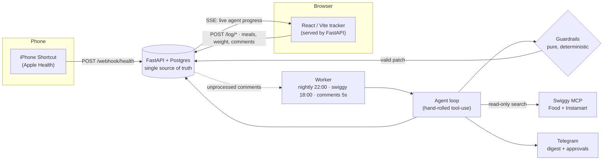

<div align="center">

# FitAgent 🏋️🤖

**A personal, safety-first AI nutrition & training agent — it watches your real day and adapts your plan, but it can never do anything it shouldn't.**

It reads your Apple Health data and meal check-ins, understands plain-English updates
("skipped lunch, had 2 samosas"), rebalances your diet within hard-coded guardrails,
and recommends macro-fitting dishes from **Swiggy Food & Instamart** — *it recommends, it never orders.*

[](https://www.python.org/)
[](https://fastapi.tiangolo.com/)
[](https://www.postgresql.org/)
[](https://vitejs.dev/)
[](https://docs.anthropic.com/)
[](https://docs.docker.com/compose/)
[](https://github.com/abhinav2712/FitAgent/actions/workflows/tests.yml)

</div>

<!-- Optional hero image: drop a screenshot at docs/screenshot.png (grab a frame from the demo) and uncomment:
<p align="center"></p>
-->

**📹 Demo:** https://drive.google.com/file/d/1AvRd6IpKSmJjPakAlFD6Kvvm0u6tPYBr/view

**📖 Engineering deep-dive:** [**Case Study**](docs/CASE_STUDY.md) — architecture, system design, tech-stack choices, and the reasoning behind every major decision.

---

## Table of Contents

- [Why it's interesting](#-why-its-interesting)
- [Architecture](#-architecture)
- [Safety by construction](#-safety-by-construction)
- [Quickstart](#-quickstart)
- [The Swiggy integration](#-the-swiggy-integration)
- [Multi-user](#-multi-user)
- [Tech stack](#-tech-stack)
- [Project structure](#-project-structure)
- [Tests](#-tests)
- [Docs](#-docs)

---

## ✨ Why it's interesting

- **The LLM proposes, Python disposes.** Every plan change passes through a deterministic guardrail layer *before* it can persist. The model cannot talk its way below a 1,600 kcal floor or past a 120–150 g protein band — the limits are hard-coded constants, not prompt instructions.
- **Real Swiggy MCP integration, read-only by construction.** Food *and* Instamart, over the Model Context Protocol. The agent gets a curated whitelist of search-only tools; `place_food_order`, `checkout`, and every cart/address-mutation tool is blocked by name, with tests to prove it.
- **No framework.** The agent is a hand-rolled ~90-line tool-use loop — no LangChain, no multi-agent orchestration. Complexity is spent on guardrails and auditability, not plumbing. Every run lands one fully-auditable `agent_runs` row.
- **Feels alive.** A comment in the 🤖 chat streams a reply back token-by-token over SSE ("🔎 Checking your day…"), and three cron triggers (nightly review, dinner window, comment poll) let the agent act *proactively*, not just when asked.
- **Model-agnostic.** One env var (`ANTHROPIC_BASE_URL`) swaps between the Claude API and a free local Ollama model — same loop, same tools, same guardrails.
- **Multi-user on one deploy**, with airtight per-user data isolation injected by Python (never chosen by the model).

## 🏗 Architecture



**One server, one deploy.** The React tracker is built to `web/dist` and served by FastAPI at `/` — same origin as the API, so zero CORS. The **worker is the only thing that ever invokes the agent**; the web app just reads and writes Postgres and watches runs stream by.

## 🛡 Safety by construction

The whole system is built so the dangerous things are *impossible*, not merely *discouraged*:

| Guarantee | How it's enforced |
|---|---|
| **Never orders food** | Swiggy client whitelists read-only search tools; `_assert_allowed()` runs before every network call. Cart / checkout / order / address-write tools are blocked by name. |
| **Never starves you** | `guardrails.py` — pure functions, no I/O — reject any plan below **1,600 kcal**, outside **120–150 g protein**, or swinging a day's calories **> ±15%**. Fails closed. |
| **Never edits history** | Plans are append-only versions (new version + RFC-6902 patch + rationale). Rollback = a new version, never an UPDATE. |
| **Never crosses users** | `user_id` is injected by Python into every query from the API token — it is *not* a tool parameter the model can set. |
| **Structural changes need you** | Target / workout-schedule changes require explicit approval — an in-app card or a Telegram ✅/❌ button, ownership-checked. |
| **Always auditable** | Every agent invocation writes one `agent_runs` row: what it saw, every tool call + args, what it produced, token cost. |

## 🚀 Quickstart

```bash
cp .env.example .env        # LLM: a paid Claude API key, OR free local Ollama
                            # (set ANTHROPIC_BASE_URL — see .env.example Option B)
docker compose up --build   # → db + api (:8000) + worker; tracker UI at :8000/

# one command per person — creates the user, seeds their plan, prints their API token:
docker compose exec api python -m app.create_user "Abhi" \
  --chat-id 123456789 --profile "23M, 175cm, cutting 76->68kg"

open http://localhost:8000  # paste the token in the pairing screen
```

Talk to it — tap the floating 🤖 chat, or:

```bash
curl -X POST localhost:8000/log/comment \
  -H 'Content-Type: application/json' -H 'X-Api-Token: <your token>' \
  -d '{"date":"2026-07-07","text":"skipped lunch, ate 2 samosas at office"}'

docker compose logs -f worker   # watch it pick the comment up within ~5s and stream a reply
```

Simulate the iPhone (or set up the real Shortcut — [guide](shortcuts/SHORTCUT_SETUP.md)):

```bash
curl -X POST localhost:8000/webhook/health \
  -H 'Content-Type: application/json' -H 'X-Api-Token: <your token>' \
  -d '{"date":"2026-07-07","steps":9412,"active_kcal":410}'
```

## 🍽 The Swiggy integration

FitAgent connects to Swiggy's **Food** (`/food`) and **Instamart** (`/im`) MCP servers over streamable HTTP, authenticated per-user with OAuth 2.1 + PKCE:

```bash
docker compose exec api python -m app.swiggy_auth 1   # browser → phone + OTP, one-time
# then set SWIGGY_MOCK=false in .env and restart
```

Ask *"what's a high-protein dinner I can order tonight?"* and the agent computes your **remaining** macros server-side, searches real restaurants near your saved delivery address, and returns three fitting dishes — restaurant, price, estimated macros (always labelled **"est."**, since menus carry no nutrition data), and a one-line reason — on a **Swiggy picks** card. Ask *"what should I stock up on?"* and it does the same against Instamart on a separate card.

`SWIGGY_MOCK=true` (the default) serves a realistic built-in catalog so the whole flow works before you link an account. The read-only whitelist lives in [`agent/swiggy_mcp.py`](agent/swiggy_mcp.py).

## 👥 Multi-user

One deploy serves several people. `create_user` mints a personal API token that authenticates both that person's tracker (pairing screen) and their iPhone Shortcut (`X-Api-Token` header). Every Postgres row carries a `user_id`; cron triggers fan out per user; Telegram DMs go to each user's own chat (one bot for all); approval buttons only work from the plan owner's chat. **The LLM never selects the user — Python injects the scope into every tool call.**

## 🧰 Tech stack

| Layer | Choice |
|---|---|
| **API** | FastAPI · Uvicorn · raw SQL via SQLAlchemy `text()` (no ORM) |
| **Data** | PostgreSQL 16 — append-only plan versions, full agent audit trail |
| **Agent** | Hand-rolled Anthropic tool-use loop · model-agnostic via `ANTHROPIC_BASE_URL` (Claude API or Ollama) |
| **Integrations** | Swiggy Food + Instamart MCP · Apple Health (iPhone Shortcut webhook) · Telegram Bot |
| **Frontend** | React + Vite SPA, built into the API image, served same-origin |
| **Scheduling** | APScheduler — 3 cron triggers in one worker |
| **Ops** | Docker Compose · GitHub Actions (guardrail tests as the release gate) |

## 📁 Project structure

```text
fitagent/
├── app/                      # FastAPI service
│   ├── routers/              # logs · plan · recommendations · health_webhook · me · chat_stream
│   ├── main.py               # app + same-origin SPA mount
│   ├── security.py           # X-Api-Token → user (scoping injected here)
│   ├── create_user.py        # per-user CLI + token mint + plan seed
│   ├── swiggy_auth.py        # Swiggy OAuth 2.1 + PKCE linker
│   └── config.py · db.py · schemas.py · seed_plan.py
├── agent/                    # the agent
│   ├── loop.py               # ~90-line hand-rolled tool-use loop + audit write
│   ├── tools.py              # tool schemas + handlers (user_id injected here)
│   ├── guardrails.py         # THE safety layer — pure functions, no I/O
│   ├── swiggy_mcp.py         # Food + Instamart MCP client + read-only whitelist
│   ├── chat_stream.py        # live SSE publishing over Postgres NOTIFY
│   └── prompts.py · notify.py
├── worker/scheduler.py       # cron triggers + comment / Telegram polling
├── web/                      # React + Vite tracker (the "V-Taper Log")
├── db/schema.sql             # single source of truth for the schema
├── tests/                    # guardrail + Swiggy-whitelist tests (the release gate)
├── shortcuts/                # iPhone Shortcut setup
├── docs/                     # architecture, capabilities, coding guidelines, roadmap
└── docker-compose.yml
```

## ✅ Tests

Guardrails are the release gate — a failing guardrail test is a stop-everything bug.

```bash
docker compose exec api pytest tests/ -v
```

Covers the calorie/protein floors, the "seed plan must pass its own guardrails" invariant, fail-closed patch handling, and the Swiggy whitelist (every dangerous Food + Instamart tool verified blocked, on both services independently).

## 📚 Docs

[Engineering Case Study](docs/CASE_STUDY.md) · [Agent Capabilities](docs/CAPABILITIES.md) · [Architecture](docs/ARCHITECTURE.md) · [Implementation Plan](docs/IMPLEMENTATION_PLAN.md) · [Coding Guidelines](docs/CODING_GUIDELINES.md) · [Future Features](docs/FUTURE_FEATURES.md) · [iPhone Shortcut Setup](shortcuts/SHORTCUT_SETUP.md) · [CLAUDE.md](CLAUDE.md)

<div align="center"><sub>Built on the Swiggy Builders Club platform · recommends, never orders.</sub></div>
