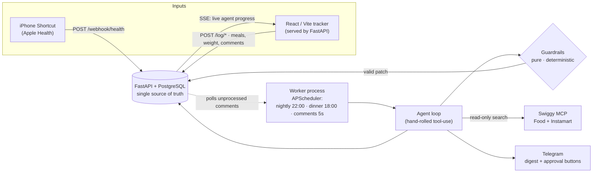
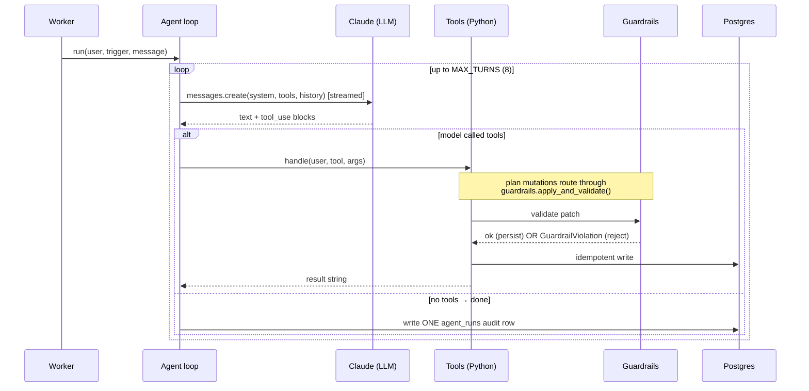
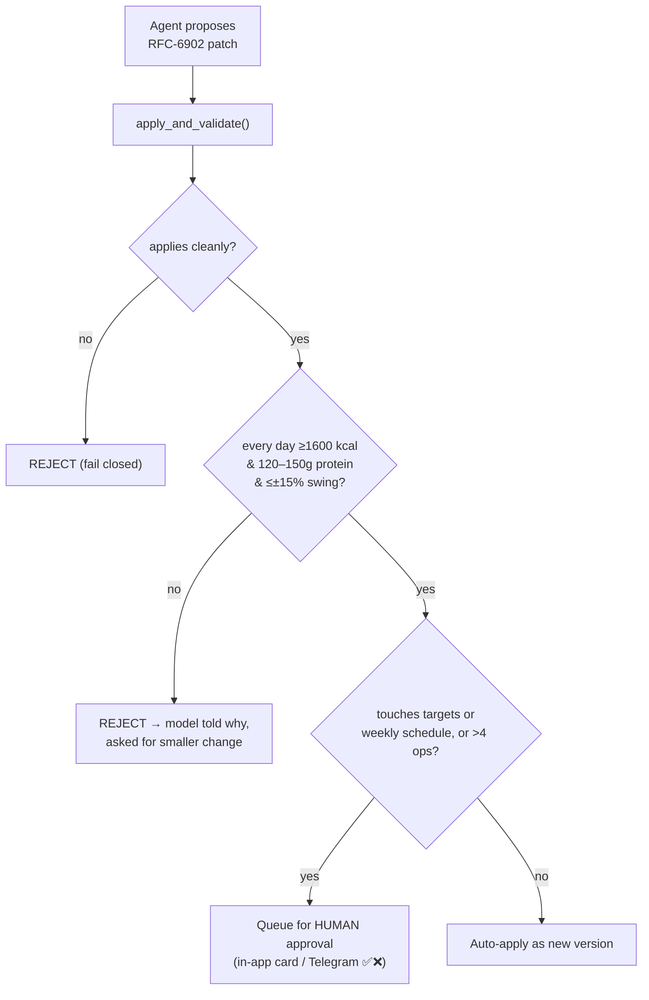
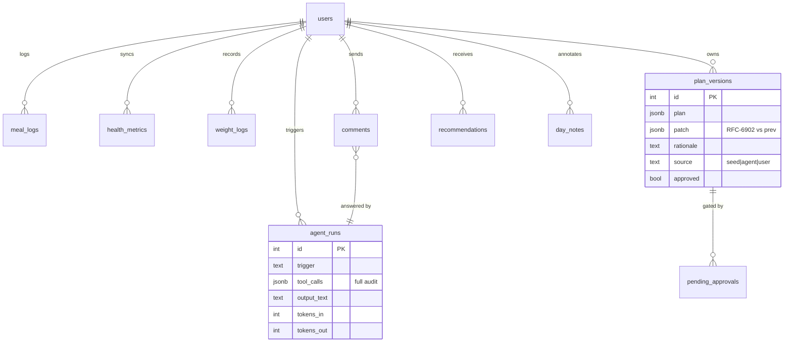

# FitAgent — Engineering Case Study

> A production-grade **agentic system** that adapts a real person's diet and training
> plan from natural-language input and live health data — wrapped in a deterministic
> safety layer so the LLM can *propose* anything but *break* nothing.
>
> This document is a deep-dive into the architecture, the engineering decisions behind
> it, and the reasoning for each — written to show how I think about building reliable
> systems around a probabilistic core.

---

## At a glance

| | |
|---|---|
| **What** | Personal AI nutrition & training agent — reads Apple Health + meal logs, understands free-text ("skipped lunch, had 2 samosas"), rebalances the plan within hard guardrails, recommends macro-fitting Swiggy dishes. |
| **Core idea** | *The LLM proposes, Python disposes.* Every mutation passes a deterministic validator before it can persist. |
| **Stack** | FastAPI · PostgreSQL 16 · hand-rolled Anthropic tool-use loop (no framework) · React/Vite · APScheduler · Docker Compose |
| **Real integrations** | Swiggy Food + Instamart (Model Context Protocol) · Apple Health (iPhone Shortcut) · Telegram Bot · Anthropic Claude / local Ollama |
| **Scale/shape** | ~1,500 LOC Python · 8 agent tools · 10 Postgres tables · 3 cron triggers · multi-user, single deploy |
| **Safety** | Hard-coded diet floors, append-only plans, read-only ordering whitelist — all test-enforced (12 tests, guardrails are the release gate) |
| **Status** | Live end-to-end; real Swiggy integration demoed to the Swiggy Builders Club |

---

## Table of contents

1. [The problem](#1-the-problem)
2. [System architecture](#2-system-architecture)
3. [The agentic core](#3-the-agentic-core)
4. [Safety architecture — the heart of the system](#4-safety-architecture--the-heart-of-the-system)
5. [Data model](#5-data-model)
6. [Tech-stack decisions & reasoning](#6-tech-stack-decisions--reasoning)
7. [Deep-dive: six decisions I'm proud of](#7-deep-dive-six-decisions-im-proud-of)
8. [Multi-user & security model](#8-multi-user--security-model)
9. [Real-world integration: Swiggy MCP](#9-real-world-integration-swiggy-mcp)
10. [Testing & observability](#10-testing--observability)
11. [Challenges & lessons learned](#11-challenges--lessons-learned)
12. [Future roadmap](#12-future-roadmap)
13. [What this project demonstrates](#13-what-this-project-demonstrates)

---

## 1. The problem

Diet tracking apps are either dumb logs (you do all the thinking) or black-box
"AI coaches" you can't trust with anything that matters. I wanted an agent that could:

- take **messy, real-life input** — "cook didn't come, ate out," "shoulder hurts, skip push day" — and *act* on it;
- stay **grounded in my actual data** — what I ate, my weight trend, my steps from Apple Health — not vibes;
- **close the loop** on a daily decision I actually make — *what do I order for dinner that fits my macros?* — using real restaurant data;
- and critically, be **safe enough to let loose**: an agent that can rewrite my diet plan must never be able to talk itself into starving me or spending my money.

That last requirement is the whole thesis. The interesting engineering problem in agentic
systems isn't "can the model do the task" — it's **"how do you let a probabilistic model
drive real state without it being able to do something catastrophic?"** FitAgent is my
answer to that question, built end to end.

---

## 2. System architecture



**The shape in one paragraph.** A FastAPI service owns all HTTP and all database access;
Postgres is the single source of truth. The React tracker is built into the same Docker
image and served at `/` — same origin, so zero CORS, one deploy, one URL. A **separate
worker process** is the *only* thing that ever invokes the agent: it runs three cron
triggers and polls a comments table (the agent's "inbox"). The agent is a plain loop over
Anthropic's tool-use API; its tools read and write Postgres, call Swiggy over MCP, and
send Telegram messages. Every plan mutation is forced through a deterministic guardrail
module before it can touch the database.

**Why this separation.** The agent is slow, bursty, and failure-prone (LLM calls, network,
third-party APIs). Keeping it in a worker means a hung agent run can never stall a user's
tap in the UI — the API stays snappy because its job is just typed reads/writes to Postgres.
This is the classic **"fast path / slow path" split**, and it falls out naturally from
"business logic lives behind the API; the worker calls the API or shared modules."

---

## 3. The agentic core

The agent is a **~90-line hand-rolled loop** over Anthropic's Messages API with tool use.
No LangChain, no agent framework. The entire control flow:



**Eight tools**, each a small Python function dispatched by name:
`get_day_context`, `log_offplan_food`, `propose_plan_patch`, `search_swiggy`,
`search_instamart`, `create_recommendation`, `notify_user`, `add_day_note`.

Three design rules make this loop trustworthy:

1. **The user is never a tool parameter.** `tools.handle(user, name, args)` receives the
   authenticated user dict from the caller and injects `user_id` into every query. The
   LLM cannot read or write another user's data *by construction* — there's no argument
   it could set to try.
2. **Deterministic math never goes to the model.** "How many calories do I have left" is
   computed in Python inside `get_day_context` and handed to the model as a fact. (I learned
   this the hard way — see [§11](#11-challenges--lessons-learned).)
3. **Every invocation lands exactly one `agent_runs` row** — the full input, every tool
   call with arguments, the output, and token cost. That table is the debugger: any agent
   behavior is reconstructable from data, not print statements.

`MAX_TURNS = 8` is the runaway-cost brake. The loop is intentionally boring — no retries,
no parallel dispatch, no sub-agents — because at this scale (one user, three triggers,
eight tools) that machinery would be complexity I haven't earned.

---

## 4. Safety architecture — the heart of the system

This is the part I'd most want to talk through in an interview, because it's where the
engineering lives. The principle is **"the LLM proposes, Python disposes":** the model
can suggest any change, but a deterministic layer decides whether it's allowed.

### Guardrails: pure functions, no I/O

`agent/guardrails.py` takes a plan document and a proposed RFC-6902 JSON Patch, applies
it, and either returns the new plan or raises `GuardrailViolation`. It has **no database
access, no network, no settings reads** — which is exactly what makes it exhaustively unit-
testable. The constitution is hard-coded:

```python
KCAL_FLOOR = 1600                 # never plan a day below this
PROTEIN_MIN, PROTEIN_MAX = 120, 150
MAX_DAY_KCAL_CHANGE_PCT = 15      # one agent patch can't swing a day >15%
```



Four properties make this hold:

- **Fails closed.** If the patch can't even be applied (bad path, bad op), that's a
  rejection the model can react to — never a crash that falls through to persisting. I
  found and fixed exactly this class of bug when a weaker local model emitted a patch
  against a nonexistent path.
- **Constants are constitution.** The floors change only when *I* ask, in my own words —
  an agent (or a comment routed through the agent) suggesting it is not authorization.
- **One gate for all plan writes.** The only path that writes `plan_versions` from agent
  output is `tools.py → apply_and_validate() → INSERT`. No "internal trusted" shortcuts.
- **The seed plan must pass its own guardrails** — enforced by a test, because full-plan
  revalidation means one non-compliant day would block *every* future patch.

### The ordering whitelist: read-only by construction

Swiggy's MCP servers expose ordering tools — `place_food_order`, `update_food_cart`,
`checkout` — against **production Swiggy, real money**. FitAgent can never call them, not
because a prompt says so, but because:

```python
FOOD_ALLOWED_TOOLS      = {"search_restaurants", "search_menu", "get_restaurant_menu", "get_addresses"}
INSTAMART_ALLOWED_TOOLS = {"search_products", "get_addresses"}
# _assert_allowed(service, tool) runs before EVERY network call.
```

It's a **whitelist, not a blocklist** — a new dangerous tool Swiggy ships tomorrow is
blocked by default. Tests assert every known cart/checkout/order/address-mutation tool
raises on both services independently, so weakening the whitelist turns the build red. The
agent never even sees Swiggy tool names; it gets a curated `search_swiggy` / `search_instamart`
facade.

### Human-in-the-loop for structural changes

Small same-day tweaks auto-apply (and are audited). But anything structural — changing my
calorie/protein **targets**, my **weekly workout schedule**, or a large multi-edit patch —
is queued as a pending approval and surfaced as an **in-app approval card** and a **Telegram
message with ✅/❌ buttons**. Both resolve through one ownership-checked endpoint. The agent
proposes; I decide.

---

## 5. Data model

Ten tables, every one carrying `user_id`. Three design choices define it:



1. **Plans are append-only.** A plan change is a *new row* (full plan + the patch that
   produced it + a rationale + its source). Never an `UPDATE`. This gives free version
   history, trivial rollback (insert a row equal to an old one), and a complete audit of
   *why* the plan looks the way it does. The "active" plan is just the latest approved row.
2. **The agent is fully audited.** `agent_runs` stores every run's inputs, tool-call trace,
   output, and token cost. This is observability designed in from day one — I debug agent
   behavior by reading rows, not by adding logging.
3. **Idempotent writes everywhere.** Day-keyed tables use composite natural keys
   (`UNIQUE(user_id, date, meal_id)`) with `ON CONFLICT` upserts, because the phone re-sends,
   the worker re-polls, and Telegram re-delivers. Every write path tolerates replay.

JSONB holds the documents the agent *reasons about* (the plan, tool-call traces); real
columns hold anything I *filter or aggregate* on (dates, kcal, tokens). Queryable fields
never hide inside JSONB.

---

## 6. Tech-stack decisions & reasoning

I treated "what does *this* system actually need" as the question, not "what's the most
impressive architecture." Every row below is a deliberate choice with a rejected alternative.

| Decision | Chose | Over | Why |
|---|---|---|---|
| **Agent framework** | Hand-rolled ~90-line loop | LangChain / LlamaIndex / CrewAI | At 8 tools and 3 triggers, a framework adds abstraction, hidden control flow, and dependency risk for zero benefit. The loop *is* the artifact — fully readable and auditable. |
| **Web framework** | FastAPI | Flask / Django | Native async for the LLM/MCP I/O, Pydantic validation at the boundary for free, and it's the de-facto standard for Python AI services. |
| **DB access** | Raw SQL via `sqlalchemy.text()` | ORM models | Explicit SQL keeps the data layer transparent and the audit/idempotency logic obvious. No lazy-loading surprises, no migration-framework overhead at this scale. |
| **Database** | PostgreSQL | SQLite / Mongo | JSONB for agent documents *and* relational columns for queryable fields in one engine — plus `LISTEN/NOTIFY` for live streaming (below). SQLite can't do the pub/sub; Mongo loses the relational integrity. |
| **Live chat delivery** | SSE over Postgres `NOTIFY` | WebSockets / a new sync endpoint | The worker already runs the agent; it just *publishes* progress. No second agent invocation path, no new stateful server — the DB I already have becomes the message bus. |
| **Scheduling** | APScheduler in one worker | Celery + Redis | Three cron jobs and a 5-second poll do not justify a broker and worker pool. One process, no Redis, no queue infra. |
| **LLM access** | Anthropic SDK, model-agnostic via `base_url` | Hard-wired to one model/provider | One env var swaps Claude for a local Ollama model with zero code change — free local dev, and no vendor lock-in. |
| **Deploy** | Docker Compose, single VM | Kubernetes / serverless | At "a handful of users on one box," anything bigger is operational complexity with no payoff. |

The through-line: **complexity is spent on guardrails and auditability only.** Everywhere
else, the boring choice wins unless there's a concrete reason — and "it looks more senior"
isn't one.

---

## 7. Deep-dive: six decisions I'm proud of

**1. Hand-rolling the agent loop.** The temptation with agents is to reach for a framework.
I deliberately didn't, and wrote down *why* as a project invariant. The payoff: when a
local model started ending runs on a bare tool call without a final reply, I could fix it
in the loop in five minutes because there was no framework between me and the control flow.

**2. Live streaming without breaking the "single invocation path" invariant.** I wanted the
chat to stream token-by-token (like a modern assistant). The naive move is a new synchronous
`POST /chat` that calls the LLM — but that would create a *second* way to invoke the agent,
duplicating the audit trail and the guardrail routing. Instead: the worker's existing run
publishes `activity`/`delta`/`done` events over Postgres `NOTIFY`; a read-only SSE endpoint
relays them. Live UX, zero new agent paths, and if nobody's listening the durable record
still reconciles the UI. *Preserving an architectural invariant while adding a user-facing
feature* is the decision I'd most want to defend in review.

**3. Model-agnostic backend.** Routing all LLM calls through a configurable `base_url` means
the exact same loop, tools, and guardrails run against the Claude API *or* a free local
Ollama model. I developed and demoed entirely on local models at zero cost, and the
guardrails make that safe — a weaker model is still boxed by the same deterministic floors.

**4. Partial-merge health webhook (learned from the field).** My steps and calories came
from two separate iPhone Shortcuts, and the second kept zeroing the first's data because
the webhook overwrote all fields. I changed it to a `COALESCE`-based partial merge where an
incoming `0` for a cumulative counter means "this source has no reading" and leaves the
stored value alone. Multiple independent data sources now update their own fields without
clobbering — a small, well-reasoned bit of non-obvious SQL, documented with its rationale.

**5. Address-anchored Swiggy search (learned from production).** The docs implied Swiggy's
search took GPS coordinates. Production returned `"addressId is required"`. My safety tests
caught the whitelist change I needed (adding read-only `get_addresses`), I extended it
correctly, and — important for privacy — the agent only ever receives an opaque address ID;
the full home-address text never leaves the resolver function. Building against a real API,
hitting a real surprise, and handling it *safely* is the story I'm proudest of.

**6. "Earn the complexity" as a written rule.** The coding guidelines include a table of
things *not* to build yet (LISTEN/NOTIFY, per-user schedules, a queue, structured logging)
with the specific trigger condition that would justify each. Deciding what *not* to build —
and writing down why — is, to me, the clearest signal of engineering maturity.

---

## 8. Multi-user & security model

One deploy serves several people with hard data isolation:

- **Per-user API token.** `create_user` mints a token that authenticates both the person's
  tracker (a pairing screen) and their iPhone Shortcut (`X-Api-Token` header). The server
  resolves token → user row; a wrong token is a 401 and nothing is served from cache.
- **`user_id` is code-injected, never model-chosen.** Every table has it; every query
  filters on it; it's bound in Python at the tool-dispatch boundary. A query missing a
  `user_id` filter is treated as a guardrail bypass, not a style nit.
- **Ownership is verified on sensitive actions.** Approval resolution checks the plan owner
  *and*, for Telegram, that the button press came from the owner's chat (all users share one
  bot). Cross-user actions are impossible by the same construction-not-instruction principle
  as everything else.

(HMAC request signing and token rotation are documented as the explicit next step before
exposing this beyond a trusted circle — called out honestly rather than half-built.)

---

## 9. Real-world integration: Swiggy MCP

FitAgent is a **Model Context Protocol client** to two of Swiggy's production MCP servers
(Food and Instamart), authenticated per-user with **OAuth 2.1 + PKCE** (phone + OTP in the
browser, via a small linker CLI I wrote). This is genuine third-party integration, not a toy:

- The agent computes remaining macros, searches real restaurants near my saved delivery
  address, and returns three fitting dishes — restaurant, price, **estimated** macros (always
  labelled "est." because menus carry no nutrition data), and a one-line reason — on a card.
- A separate Instamart path does the same for grocery/snack stocking.
- Two **independent** whitelists (a tool allowed on one service can't leak onto the other),
  test-enforced.

I built this openly on the **Swiggy Builders Club** platform and demoed the live integration
back to their team. The whole thing is designed so that even running against production
Swiggy, **ordering is structurally impossible.**

---

## 10. Testing & observability

**Testing is risk-proportional.** I don't unit-test the LLM — I test its *containment*.
The 12 tests concentrate on the two places a bug is catastrophic:

- **Guardrails** (the diet floors, the fail-closed patch handling, the "seed plan passes its
  own guardrails" invariant) — these are the *release gate*; a failing guardrail test is a
  stop-everything bug.
- **The Swiggy whitelist** (every dangerous tool on both services verified blocked, plus a
  test that the two whitelists stay independent).

CI runs them on every push. **Observability is the `agent_runs` table** — designed in, not
bolted on. I can answer "what did the agent do and why" for any run by reading one row's
`tool_calls` JSONB, which made debugging agent behavior a database query instead of a
guessing game.

---

## 11. Challenges & lessons learned

- **Letting the model do arithmetic was a bug.** A weaker local model, asked for dinner
  ideas, subtracted the *planned menu* from my target instead of my *logged* meals and
  concluded I had ~60 kcal left on an empty stomach. Fix: compute remaining macros
  deterministically in Python and hand them to the model as a fact. **Lesson: keep the
  numbers that matter out of the probabilistic layer.**
- **Timezones bit the cron.** The worker runs in UTC; a post-midnight-IST trigger stamped
  data with "yesterday," so recommendations saved under the wrong date. Fix: compute "today"
  in the user's timezone at the trigger boundary. **Lesson: the day boundary is always the
  *user's* day.**
- **Production contradicted the docs** (Swiggy's addressId requirement). **Lesson: integrate
  against the real thing early; your tests are what let you adapt safely when it surprises you.**
- **A full-overwrite webhook silently destroyed data** when two data sources wrote the same
  row. **Lesson: ingestion endpoints that merge independent partial updates need to be
  explicitly partial — and idempotency is a feature, not an afterthought.**

Each of these is now a regression test or a documented invariant, named after the failure mode.

---

## 12. Future roadmap

Prioritized, with the trigger that would justify each (nothing gets built before it's earned):

- **Cheap-model intent triage** — a Haiku-class classifier gates comments so only plan-
  affecting ones hit the strong model (the `classifier_model` slot already exists, unused).
  *Trigger: cost.*
- **Deterministic TDEE estimation** — infer true maintenance calories from the weight-trend-
  vs-intake math (in Python, feeding a new guardrail), unlocking a smarter deficit cap.
- **Meal photos → macro estimates** — a vision call in the comment pipeline; the highest-
  leverage friction-killer.
- **Weekly trend review** — a fourth cron that spots plateaus and proposes one structural
  change (routed through the existing approval flow).
- **Progressive-overload tracking**, **sleep/recovery data**, **HMAC signing + token rotation**
  (the security upgrade before any wider exposure).

Full list with effort estimates in [`docs/FUTURE_FEATURES.md`](FUTURE_FEATURES.md).

---

## 13. What this project demonstrates

Mapping the work to what an AI Software Engineer role actually needs:

| Capability | Where it shows up here |
|---|---|
| **Agentic system design** | A hand-rolled tool-use loop with 8 tools, bounded turns, and a full audit trail — built, not imported. |
| **Making LLMs safe & reliable** | "LLM proposes, Python disposes": deterministic guardrails, a read-only whitelist, human-in-the-loop approvals — all test-enforced. |
| **Real integrations** | Production Swiggy MCP (OAuth 2.1 + PKCE), Apple Health, Telegram — handled including a production surprise. |
| **Backend & data engineering** | FastAPI, Postgres with append-only versioning and idempotent ingestion, `LISTEN/NOTIFY` streaming. |
| **Full-stack delivery** | A React/Vite tracker served same-origin, with offline write-queueing and live SSE. |
| **Engineering judgment** | Deliberate "earn the complexity" choices, written invariants, and honesty about what's deferred and why. |
| **Production awareness** | Multi-user isolation, observability-by-design, model-agnostic deploy, CI as a release gate. |

The one-line version: **I can build an agent that does something genuinely useful with real
data and real third-party APIs — and I can make it safe, debuggable, and honest about its
limits.** That combination is the whole point of FitAgent.

---

### Appendix — run it yourself

```bash
cp .env.example .env            # Claude API key, or free local Ollama (ANTHROPIC_BASE_URL)
docker compose up --build       # db + api (:8000) + worker
docker compose exec api python -m app.create_user "You" --profile "..."
open http://localhost:8000      # paste the printed token
docker compose exec api pytest tests/ -v   # the guardrail + whitelist suite
```

Repo structure, invariants, and the full coding standards live in
[`CLAUDE.md`](../CLAUDE.md), [`docs/ARCHITECTURE.md`](ARCHITECTURE.md), and
[`docs/CODING_GUIDELINES.md`](CODING_GUIDELINES.md).

<sub>FitAgent — built on the Swiggy Builders Club platform. Recommends, never orders.</sub>
